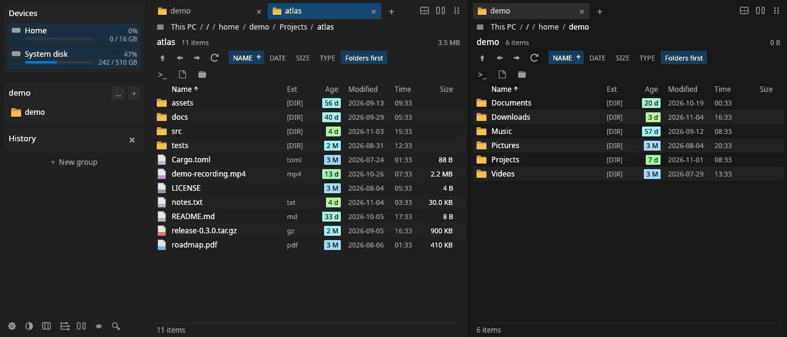

# Ferrous Commander

A fast, light multi-pane file manager for Linux and Windows, written in Rust. Split the window into as many tiled panels as you need.

**Download:** get the latest build from the
[Releases](https://github.com/minisiowo/ferrous-commander/releases) page. Windows may
warn about an unknown publisher, because the builds are not signed.

Features, installation and configuration are described in [app/README.md](app/README.md).
