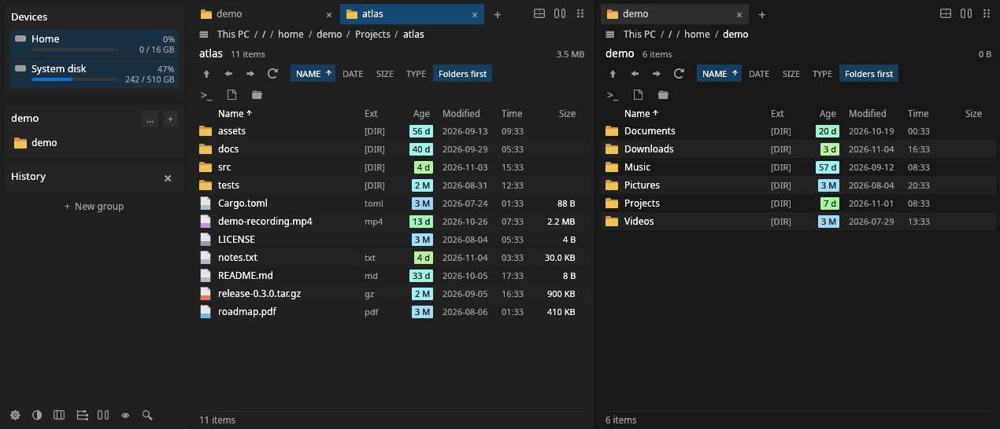

<div align="center">


# Ferrous Commander

**A fast, light multi-pane file manager for Linux and Windows, written in Rust.**

[](https://github.com/minisiowo/ferrous-commander/releases)


[Download](#download) · [Keys](#keyboard) · [Archives](#archives) · [Build](#build-from-source) · [Full reference](docs/DETAILS.md)



</div>

## Features

| | |
|---|---|
| 🪟 **Tiled panels** | As many panels as you need, split either way, with tabs you can drag between them |
| 🧭 **Navigation** | Folder columns, expandable tree, breadcrumbs, history, type to filter |
| ⭐ **Sidebar** | Favorites in groups, drives and pendrives with eject, cloud folders |
| 👁️ **Preview and search** | Space opens a floating preview of PDFs, pictures, code, documents, spreadsheets, archives, audio, video and 3D models (STL, 3MF). Search, color tags for folders and files |
| 📦 **Archives** | Unpack and create archives with nothing else to install |
| 🗑️ **Safe by default** | Delete goes to the Trash, existing files are never overwritten, cancelled jobs leave nothing behind |
| 🎨 **Themes** | Dark, Tokyo Night, Gruvbox, Catppuccin Latte, Rosé Pine, and live [Omarchy](https://omarchy.org/) theme |
| 🔌 **Works with your desktop** | System clipboard and drag and drop on Windows, native Wayland and X11 file drags on Linux |

## Download

Get the latest build from the [Releases](https://github.com/minisiowo/ferrous-commander/releases) page.

| System | File | How to install |
|---|---|---|
| Windows | `FerrousCommander-Setup.exe` | Run it |
| Windows | `FerrousCommander-windows-x64.zip` | Portable: unzip and run |
| Linux | `ferrous-commander-linux-x86_64.tar.gz` | Extract, then run `./install.sh` |

No administrator rights are needed for the per-user install, which is also available in **Settings → Install for this user**. Windows may warn about an unknown publisher because the builds are not signed. `SHA256SUMS.txt` lists the checksums.

## Keyboard

<table>
<tr><th>Files</th><th>Navigation</th><th>Panels and tabs</th></tr>
<tr valign="top"><td>

| Key | Action |
|---|---|
| <kbd>Ctrl</kbd>+<kbd>C</kbd> / <kbd>X</kbd> / <kbd>V</kbd> | Copy, cut, paste |
| <kbd>Del</kbd> | Move to Trash |
| <kbd>Shift</kbd>+<kbd>Del</kbd> | Delete for good (asks first) |
| <kbd>F2</kbd> | Rename |
| <kbd>Ctrl</kbd>+<kbd>D</kbd> | Duplicate |
| <kbd>Ctrl</kbd>+<kbd>N</kbd> | New file |
| <kbd>Ctrl</kbd>+<kbd>Shift</kbd>+<kbd>N</kbd> | New folder |

</td><td>

| Key | Action |
|---|---|
| <kbd>Alt</kbd>+<kbd>←</kbd> / <kbd>→</kbd> | Back, forward |
| <kbd>Backspace</kbd> | Parent folder |
| <kbd>\</kbd> or <kbd>Alt</kbd>+<kbd>D</kbd> | Edit path. <kbd>Tab</kbd> or <kbd>→</kbd> takes the suggested folder |
| <kbd>Ctrl</kbd>+<kbd>L</kbd> | Edit path with all of it selected |
| <kbd>Ctrl</kbd>+<kbd>F</kbd> | Search |
| <kbd>Ctrl</kbd>+<kbd>H</kbd> | Hidden files |
| <kbd>Space</kbd> | Preview |
| <kbd>`</kbd> | Folder columns |
| <kbd>F5</kbd> / <kbd>F10</kbd> | Refresh, terminal |

</td><td>

| Key | Action |
|---|---|
| <kbd>Ctrl</kbd>+<kbd>T</kbd> / <kbd>W</kbd> | New, close tab |
| <kbd>Ctrl</kbd>+<kbd>Shift</kbd>+<kbd>T</kbd> | Reopen tab |
| <kbd>Ctrl</kbd>+<kbd>Tab</kbd> | Next tab |
| <kbd>Tab</kbd> | Next panel |
| <kbd>Ctrl</kbd>+<kbd>Shift</kbd>+<kbd>Enter</kbd> | New panel |
| <kbd>Ctrl</kbd>+<kbd>Shift</kbd>+<kbd>Q</kbd> | Close panel |
| <kbd>Ctrl</kbd>+<kbd>Shift</kbd>+<kbd>J</kbd> | Flip split |

</td></tr>
</table>

**With the mouse:** drag to move, <kbd>Ctrl</kbd>+drag to copy, drag on empty space to select with a rectangle. Drag a tab to a panel's edge to split it, and double-click a divider to even out the panels.

## Archives

Double-click an archive to unpack it beside itself, or right-click the selection and choose **Compress...** to make one.

| Format | Extract | Create |
|---|:---:|:---:|
| `.zip`, `.7z` (password-protected ones can be extracted) | ✅ | ✅ |
| `.tar`, `.tar.gz`, `.tar.bz2`, `.tar.xz` | ✅ | ✅ |
| `.tar.zst` and single `.gz`, `.bz2`, `.xz`, `.zst` files | ✅ | |
| `.rar` (needs [7-Zip](https://www.7-zip.org) or `unrar`) | ✅ | |

## Configuration

Settings live in a readable Lua table, and **Settings → Open configuration folder** takes you there. Close the app before editing the file by hand.

| System | Location |
|---|---|
| Linux | `~/.config/ferrous/settings.lua` |
| Windows | `%APPDATA%\ferrous\settings.lua` |

## Build from source

You need the Rust toolchain. On Debian or Ubuntu also install `build-essential libxkbcommon-dev libgl1-mesa-dev libwayland-dev`.

```sh
cd app
sh packaging/build-linux.sh
./dist/ferrous-commander/ferrous-commander
```

On Windows, use `powershell -File packaging\build-windows.ps1`.

To build and install for the current user in one step, run `sh packaging/build-and-install-linux.sh` on Linux or `powershell -ExecutionPolicy Bypass -File packaging\build-and-install-windows.ps1` on Windows.

## More

- [Full reference](docs/DETAILS.md): every feature, limit and option in detail
- [Linux security report](LINUX_SECURITY_REPORT.md), [security review](SECURITY_REVIEW.md), [Windows filesystem audit](WINDOWS_FILESYSTEM_AUDIT.md)

Released under the [MIT License](../LICENSE).
